# 키워드림 (Grow-Dream)

> 자립을 준비하는 청년이 **경제 공부 → 진로 설계 → 후원 연결**까지 한 앱에서 해낼 수 있도록 돕는 모바일 서비스

**🔗 웹 데모: https://heychaewong.github.io/Grow-Dream-Frontend/**
(PC에서는 폰 화면 폭으로 보여요. 휴대폰 브라우저로 열면 앱처럼 쓸 수 있어요.)

직접 Figma로 기획·디자인한 서비스를 **React Native + TypeScript(Expo)** 로 구현한 프론트엔드 프로젝트예요. 백엔드 없이 화면과 사용자 흐름에 집중했고, 데이터는 모두 가상의 데이터예요.

<p>
  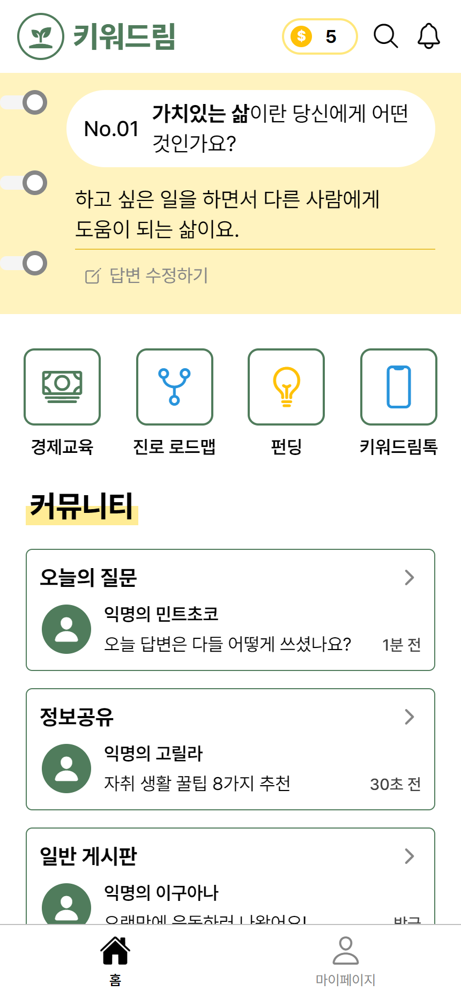
  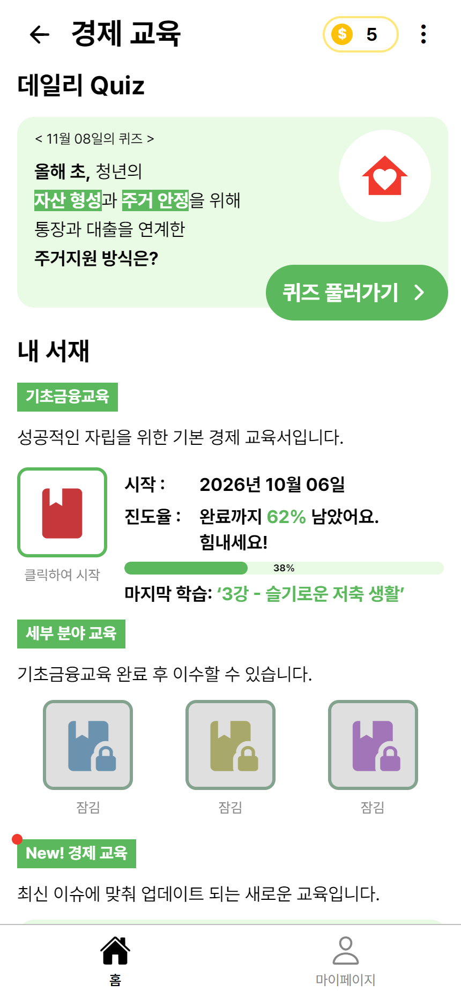
  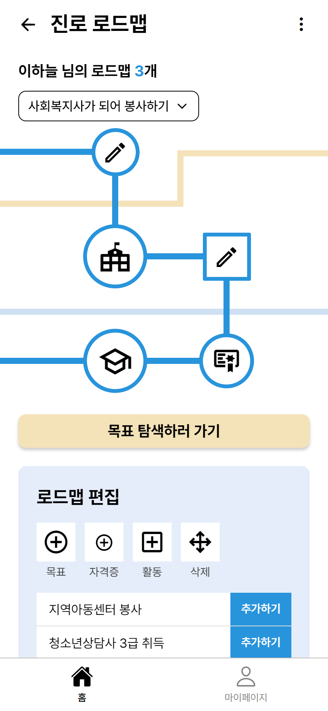
  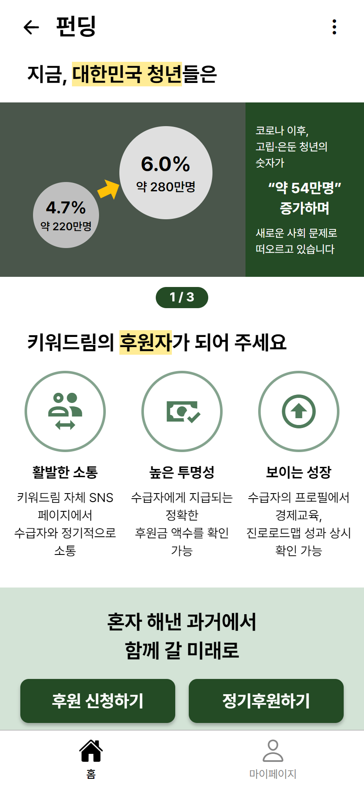
</p>

---

## 누구를 위한 서비스인가요?

보호가 끝나면 자립을 준비해야 하는 청년들은 돈 관리, 진로, 생활 정보를 **혼자서** 알아봐야 해요. 키워드림은 이 과정을 **따뜻하고 친절하게** 함께하는 것을 목표로 해요.

## 주요 기능

| 기능 | 설명 | 화면 |
|---|---|---|
| **오늘의 질문** | 하루 한 번 나를 돌아보는 질문. 화면 이동 없이 그 자리에서 답변을 쓰고 바로 확인해요. |  |
| **경제교육** | 강의 → 학습 → OX·빈칸 퀴즈. 맞히면 코인을 받고 진도율이 올라가요. 데일리 퀴즈, 오늘의 이슈, 진도율 랭킹도 있어요. | 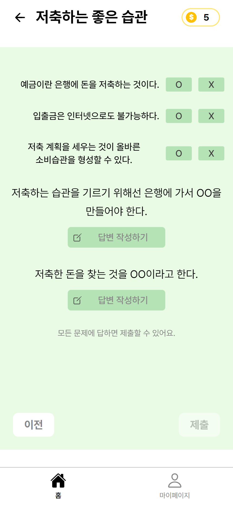 |
| **진로 로드맵** | 목표를 지하철 노선도처럼 이어 보여 줘요. 정류장(목표)을 추가·삭제·완료 표시하면 노선이 다시 그려져요. |  |
| **펀딩** | 개인 후원 신청, 기업 교육 공고 신청, 수급자 정기후원. 후원을 시작하면 키워드림톡과 연결돼요. | 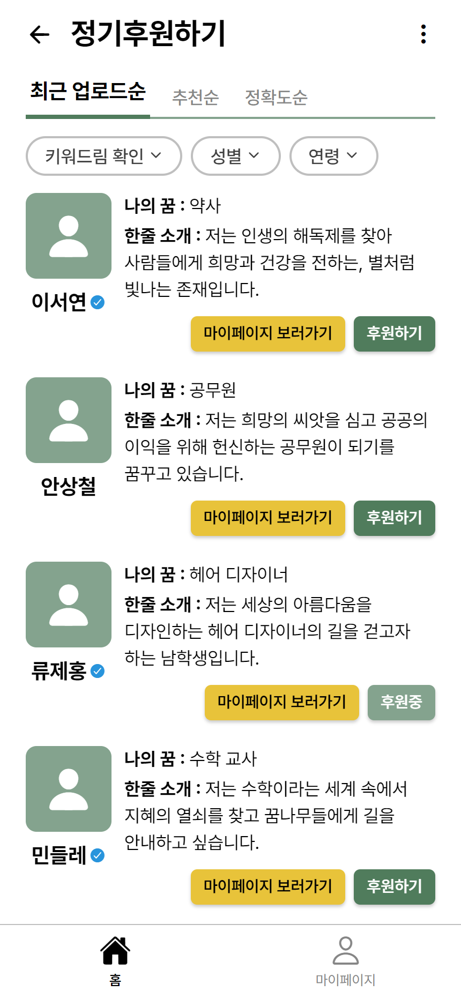 |
| **키워드림톡** | 정책·이슈 채널 소식과 후원자-수급자 대화. 응원 메시지를 보낼 수 있어요. | 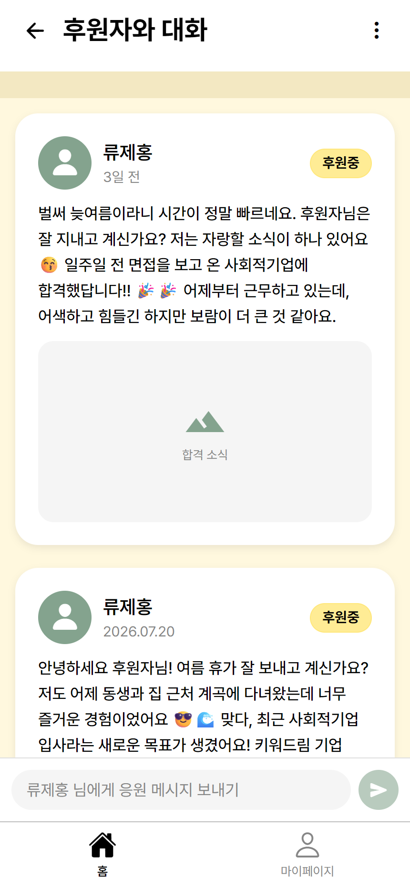 |
| **마이페이지** | 자격증·일기·질문 기록, 나의 꿈, 경제교육 진도율, 자기소개 | 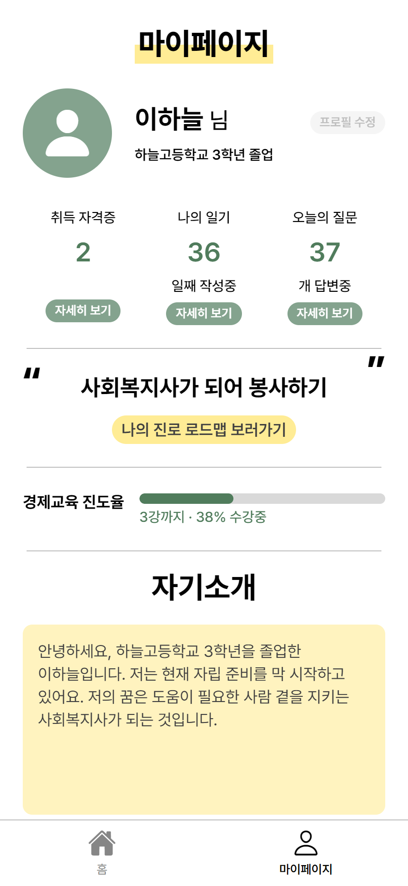 |

## 디자인

Figma 시안을 그대로 옮기는 데서 끝내지 않고, **실제 사용자에게 맞게 다시 판단하며** 코드로 옮겼어요. 전체 규칙은 [**DESIGN.md**](DESIGN.md)에 정리했어요.

### 디자인 원칙

대상은 자립에 필요한 것들을 **혼자 공부해야 하는 자립 준비 청년**이고, 목표는 **따뜻하고 친절한** 느낌이에요. 혼자 준비하는 사람 곁에서 차근차근 알려 주는 선배처럼요.

| 원칙 | 화면에서는 |
|---|---|
| 읽기 쉽게 | 본문 17px 이상, 짧은 문장 |
| 다정하게 말하기 | 해요체, 막히면 무엇을 하면 되는지 알려 주기 |
| 화면을 오가지 않게 | 짧은 입력은 그 자리에서 하고 결과도 바로 보여 주기 |
| 잘한 걸 바로 알려 주기 | 퀴즈를 맞히면 코인, 공부하면 진도율이 바로 올라가기 |

### 디자인 시스템

색·글자·간격·모서리를 **토큰**으로 정의해서([`theme.ts`](src/constants/theme.ts)) 모든 화면이 같은 값을 써요. 화면 코드에 색 값이나 글자 크기 숫자를 직접 쓰지 않아요.

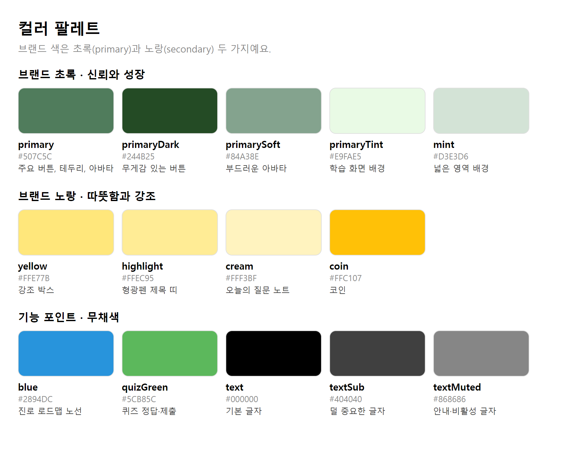

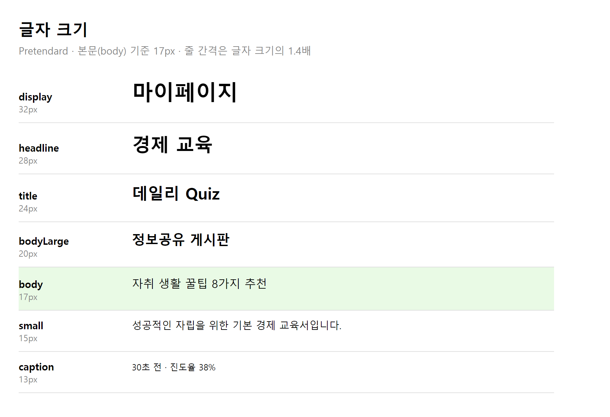

### Figma에서 코드로 옮기며 내린 디자인 결정

**1. 글자 크기를 키우고, 토큰 하나로 앱 전체에 적용**
화면을 직접 써 보니 글씨가 작아 읽기 힘들었어요. 메인 화면에서 먼저 맞는 크기를 찾고, 그 크기를 기준으로 **글자 크기 단계를 한 칸씩 올려** 앱 전체에 한 번에 적용했어요. 그다음 화면마다 "본문인데 작은 단계를 쓴 곳" 약 90곳을 하나씩 확인해서 고쳤어요.

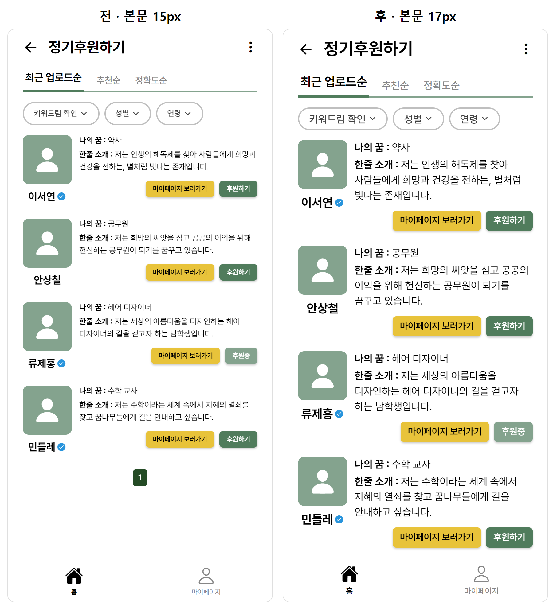

**2. 그림자를 모두 없앤 평평한 화면**
그림자는 iOS·Android·웹에서 서로 다르게 보여서 같은 디자인을 유지하기 어려워요. 그림자 대신 **배경색 차이와 테두리**로 요소를 구분해요.

**3. 화면 이동 없이 바로 답하는 "오늘의 질문"**
처음에는 답변을 쓰려면 다른 화면으로 넘어가야 했어요. 한두 줄 답변을 위해 화면을 옮기는 건 번거로워서, 노트 모양 배너 안에서 바로 입력칸이 열리고 등록하면 그 자리에 답변이 보이게 바꿨어요.

**4. 저작권을 지키는 리소스**
Figma 시안의 일러스트와 사진은 출처를 확인할 수 없어서 쓰지 않았어요.
- 아이콘과 로고 → 오픈소스 아이콘(`@expo/vector-icons`)
- 인물 사진 → 아바타, 기타 사진 → 임시 그림
- 실제 인물 이름 → 가상의 이름, 출처 없는 통계 → 쓰지 않음
- 폰트 → [Pretendard](https://github.com/orioncactus/pretendard) (SIL OFL 1.1)

**5. 접근성**
작은 버튼은 누르는 범위를 44px 이상으로 넓히고(`hitSlop`), 글자 없는 아이콘 버튼에는 화면 낭독기용 이름을 붙였어요.

## 기술 스택

| 분류 | 사용 기술 |
|---|---|
| 언어 | TypeScript |
| 프레임워크 | React Native 0.88, React 19, **Expo SDK 58** |
| 라우팅 | **Expo Router** (파일 기반 라우팅, typed routes) |
| 상태 관리 | React Context (기능별 store 3개) + AsyncStorage(기기 저장) |
| 그래픽 | react-native-svg (진로 로드맵 노선도) |
| 웹 | react-native-web, 정적 렌더링(Static export) |
| 테스트 | Jest(jest-expo), React Native Testing Library |
| 품질 | ESLint, `tsc --noEmit`, React Compiler |
| CI/CD | GitHub Actions: PR마다 타입체크·린트·테스트, main에 합쳐지면 GitHub Pages 자동 배포 |

하나의 코드로 **iOS · Android · 웹**을 함께 지원하도록 만들었어요.

## 개발 설계 포인트

### 1. 노선도처럼 그리는 진로 로드맵 (SVG)
목표 개수에 따라 정류장 위치를 계산하고, 정류장 사이를 지그재그 노선으로 이어서 SVG로 그려요. 목표를 추가하거나 지우면 위치와 노선이 자동으로 다시 계산돼요. 정류장은 SVG 위에 버튼으로 겹쳐서 눌러서 상세 정보를 볼 수 있어요.
→ [`src/components/roadmap/route-map.tsx`](src/components/roadmap/route-map.tsx)

### 2. 기능별로 나눈 전역 상태
코인·학습 진도(`app-store`), 로드맵(`roadmap-store`), 후원(`funding-store`)을 따로 관리해요. 예를 들어 펀딩에서 정기후원을 시작하면 키워드림톡에 그 수급자의 채널이 바로 생기고, 퀴즈를 맞히면 모든 화면의 코인 수가 함께 바뀌어요.
→ [`src/store/`](src/store/)

### 3. 새로고침해도 남는 데이터
코인, 학습 진도, 오늘의 질문 답변, 로드맵, 후원 내역을 기기에 저장해요(앱은 기기 저장소, 웹은 브라우저 저장소). `usePersistentState` 훅 하나로 세 store가 같은 방식으로 저장돼요.
- **첫 화면은 항상 기본값으로 그려요.** 웹은 미리 만든 HTML과 첫 화면이 같아야 해서, 저장된 값은 화면이 뜬 직후에 불러와요.
- **불러오기 전에는 저장하지 않아요.** 그러지 않으면 기본값이 저장된 값을 덮어써요.
- 저장 키에 버전(`grow-dream:v1:`)을 붙여서, 데이터 모양이 바뀌어도 예전 값과 섞이지 않게 했어요.

→ [`src/store/persist.ts`](src/store/persist.ts)

### 4. 테스트하기 쉬운 구조
store 안에 섞여 있던 계산(코인 보상, 장 완료, 진도율, 목표 추가·삭제, 후원)을 **React와 상관없는 순수 함수**로 분리했어요(`*-logic.ts`). store는 이 함수를 불러 쓰기만 해서, 화면 없이도 로직만 따로 테스트할 수 있어요.

| 테스트 | 확인하는 것 |
|---|---|
| [`app-logic`](__tests__/app-logic-test.ts) | 같은 퀴즈로 코인을 두 번 받지 않기, 장은 순서대로만 완료, 앞 강의를 끝내야 다음 강의가 열림 |
| [`roadmap-funding-logic`](__tests__/roadmap-funding-logic-test.ts) | 새 목표는 최종 목표 앞에 들어감, 같은 수급자는 금액만 바뀜, 중복 신청 방지 |
| [`ui-logic`](__tests__/ui-logic-test.ts) | 빈칸 퀴즈는 띄어쓰기를 무시하고 채점, `**굵게**`·`==형광펜==` 파싱, 노선도 정류장 좌표 |
| [`persist`](__tests__/persist-test.ts) | 저장된 값 불러오기, 바뀐 값 저장, 불러오기 전 덮어쓰기 방지, 깨진 값이면 기본값 |

### 5. 크로스 플랫폼 디테일
- **한글 줄바꿈:** 웹 브라우저는 한글을 글자 단위로 끊어서, 웹에서만 단어 단위(`word-break: keep-all`)로 바꿨어요.
- **Android 폰트:** Android는 직접 넣은 폰트의 굵기(`fontWeight`)를 무시해서, Pretendard를 굵기마다 다른 이름으로 등록했어요.
- **웹 정적 배포:** 화면마다 HTML을 미리 만들어서, 강의·대화 같은 동적 주소로 바로 들어와도 열리게 했어요(`generateStaticParams`).

## 프로젝트 구조

```
src/
├─ app/            # 화면 (Expo Router: 파일 하나 = 화면 하나)
│  ├─ _layout.tsx  # 폰트, 전역 상태, 웹 가운데 정렬
│  └─ (tabs)/      # 하단 탭: 홈 / 마이페이지
│     └─ (home)/   # 홈 탭 안의 화면들 (education, roadmap, funding, talk)
├─ components/     # 화면에서 쓰는 컴포넌트 (ui/ 는 공통 컴포넌트)
├─ constants/      # 디자인 토큰 (theme.ts)
├─ data/           # 가상 데이터
└─ store/          # 전역 상태 (Context) + 순수 로직(*-logic.ts) + 기기 저장(persist.ts)
__tests__/         # 단위 테스트 (Jest)
```

## 실행 방법

```bash
npm install
npx expo start      # w: 웹으로 열기 / 휴대폰은 Expo Go 앱으로 QR 코드 스캔
```

```bash
npx tsc --noEmit    # 타입체크
npx expo lint       # 린트
npm test            # 테스트
npx expo export -p web   # 웹 정적 빌드 (dist/)
```

## 작업 방식

- 기능 단위로 브랜치를 만들고 **PR로 합쳐요.** PR에는 무엇을, 왜 바꿨는지와 확인한 것을 남겨요([PR 템플릿](.github/pull_request_template.md)).
- PR을 올리면 GitHub Actions가 타입체크·린트·테스트를 자동으로 돌려요([`ci.yml`](.github/workflows/ci.yml)).
- `main`에 합쳐지면 다시 한번 검사한 뒤 웹 데모를 자동으로 배포해요([`deploy.yml`](.github/workflows/deploy.yml)).

## 라이선스

코드는 [MIT 라이선스](LICENSE)를 따라요. 폰트 Pretendard는 [SIL Open Font License 1.1](assets/fonts/LICENSE-Pretendard.txt)을 따라요.
